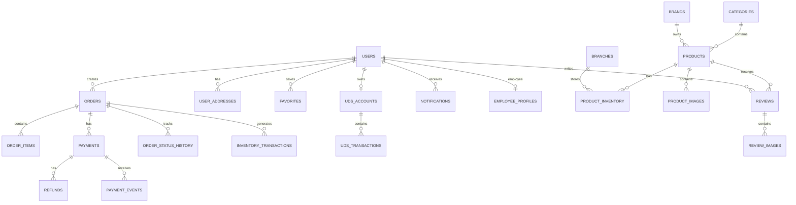

# HVAVAN Skin — DATABASE SCHEMA
## Техническое проектирование базы данных

**Проект:** HVAVAN Skin  
**Документ:** Database Schema  
**СУБД:** PostgreSQL (предлагаемый вариант)  
**Тип системы:** E-commerce Platform  
**Версия документа:** 1.0  
**Формат:** Markdown  

---

# 1. ОБЩАЯ АРХИТЕКТУРА БАЗЫ ДАННЫХ

База данных HVAVAN Skin предназначена для централизованного хранения и обработки информации всех компонентов системы:

1. Веб-сайт.
2. Мобильное приложение.
3. Административная панель.
4. Панель менеджера.
5. Складской учёт.
6. Заказы и платежи.
7. Программа лояльности UDS.
8. Аналитика.
9. Уведомления.
10. Интеграции с внешними сервисами.

## 1.1. Основные принципы проектирования

- Единая база данных для всех платформ.
- Разделение клиентских и административных прав.
- Раздельный учёт складских остатков по филиалам.
- Сохранение истории заказов и платежей.
- Сохранение истории изменения цен и остатков.
- Защита от повторного списания товаров.
- Защита от повторной обработки платежей.
- Использование внешних ключей для обеспечения целостности данных.
- Использование транзакций для критически важных операций.
- Хранение денежных значений в `NUMERIC`, а не `FLOAT`.
- Использование UTC для хранения времени с отображением локального времени пользователю.

## 1.2. Соглашения

| Обозначение | Значение |
|---|---|
| PK | Primary Key — первичный ключ |
| FK | Foreign Key — внешний ключ |
| UQ | Unique — уникальное значение |
| NN | NOT NULL — обязательное поле |
| IDX | Index — индекс |
| DEFAULT | Значение по умолчанию |
| JSONB | Структурированные JSON-данные |

Основной идентификатор таблиц — `UUID`.

---

# 2. ПОЛЬЗОВАТЕЛИ И АВТОРИЗАЦИЯ

## 2.1. Таблица `users`

Хранит информацию о клиентах и базовых пользовательских аккаунтах.

| Поле | Тип данных | Ограничения | Описание |
|---|---|---|---|
| id | UUID | PK | ID пользователя |
| first_name | VARCHAR(100) | NULL | Имя |
| last_name | VARCHAR(100) | NULL | Фамилия |
| phone | VARCHAR(20) | UQ | Номер телефона |
| email | VARCHAR(255) | UQ, NULL | Email |
| birth_date | DATE | NULL | Дата рождения |
| gender | VARCHAR(20) | NULL | Пол |
| avatar_url | TEXT | NULL | Фото профиля |
| preferred_language | VARCHAR(5) | DEFAULT 'ru' | Язык интерфейса |
| is_active | BOOLEAN | DEFAULT TRUE | Активность аккаунта |
| phone_verified_at | TIMESTAMPTZ | NULL | Подтверждение телефона |
| email_verified_at | TIMESTAMPTZ | NULL | Подтверждение email |
| deleted_at | TIMESTAMPTZ | NULL | Дата удаления аккаунта |
| created_at | TIMESTAMPTZ | DEFAULT NOW() | Дата создания |
| updated_at | TIMESTAMPTZ | DEFAULT NOW() | Дата изменения |

**Назначение:**
- Регистрация клиентов.
- Хранение персональных данных.
- Управление профилем.
- Связь пользователя с заказами, адресами и UDS.

Телефон должен быть уникальным для активного аккаунта. Политику повторного использования номера после удаления аккаунта необходимо определить отдельно.

## 2.2. Таблица `user_auth_providers`

Хранит подключённые способы авторизации.

| Поле | Тип данных | Ограничения | Описание |
|---|---|---|---|
| id | UUID | PK | ID записи |
| user_id | UUID | FK → users.id | Пользователь |
| provider | VARCHAR(30) | NN | phone, google, email, apple, password |
| provider_user_id | VARCHAR(255) | NULL | ID пользователя у провайдера |
| password_hash | TEXT | NULL | Хеш пароля |
| created_at | TIMESTAMPTZ | DEFAULT NOW() | Дата создания |
| updated_at | TIMESTAMPTZ | DEFAULT NOW() | Дата изменения |

Уникальность: `(provider, provider_user_id)`.

Пароль хранится только в виде безопасного хеша. Сырые пароли и токены провайдеров сохранять запрещено.

## 2.3. Таблица `verification_codes`

Хранит коды подтверждения телефона и другие одноразовые коды.

| Поле | Тип данных | Ограничения | Описание |
|---|---|---|---|
| id | UUID | PK | ID записи |
| phone | VARCHAR(20) | NN | Номер телефона |
| code_hash | TEXT | NN | Хеш кода |
| purpose | VARCHAR(30) | NN | Назначение кода |
| expires_at | TIMESTAMPTZ | NN | Срок действия |
| attempts | INTEGER | DEFAULT 0 | Количество попыток |
| verified_at | TIMESTAMPTZ | NULL | Время подтверждения |
| created_at | TIMESTAMPTZ | DEFAULT NOW() | Дата создания |

После окончания срока действия код не должен приниматься системой.

## 2.4. Таблица `user_sessions`

Хранит активные пользовательские сессии.

| Поле | Тип данных | Ограничения | Описание |
|---|---|---|---|
| id | UUID | PK | ID сессии |
| user_id | UUID | FK → users.id | Пользователь |
| refresh_token_hash | TEXT | NN | Хеш refresh token |
| device_name | VARCHAR(255) | NULL | Устройство |
| device_type | VARCHAR(50) | NULL | Тип устройства |
| ip_address | INET | NULL | IP-адрес |
| user_agent | TEXT | NULL | User Agent |
| expires_at | TIMESTAMPTZ | NN | Срок действия |
| revoked_at | TIMESTAMPTZ | NULL | Время завершения |
| created_at | TIMESTAMPTZ | DEFAULT NOW() | Дата создания |

## 2.5. Таблица `user_addresses`

Адреса клиентов.

| Поле | Тип данных | Ограничения | Описание |
|---|---|---|---|
| id | UUID | PK | ID адреса |
| user_id | UUID | FK → users.id | Владелец |
| title | VARCHAR(100) | NULL | Название адреса |
| city | VARCHAR(100) | NN | Город |
| street | VARCHAR(255) | NN | Улица |
| building | VARCHAR(50) | NULL | Дом |
| apartment | VARCHAR(50) | NULL | Квартира |
| entrance | VARCHAR(50) | NULL | Подъезд |
| floor | VARCHAR(20) | NULL | Этаж |
| comment | TEXT | NULL | Комментарий |
| latitude | NUMERIC(10,7) | NULL | Широта |
| longitude | NUMERIC(10,7) | NULL | Долгота |
| is_default | BOOLEAN | DEFAULT FALSE | Основной адрес |
| created_at | TIMESTAMPTZ | DEFAULT NOW() | Дата создания |

## 2.6. Таблица `employee_profiles`

Дополнительная информация о сотрудниках.

| Поле | Тип данных | Ограничения | Описание |
|---|---|---|---|
| id | UUID | PK | ID сотрудника |
| user_id | UUID | FK, UQ → users.id | Пользователь |
| employee_number | VARCHAR(50) | UQ | Табельный номер |
| position | VARCHAR(100) | NULL | Должность |
| is_active | BOOLEAN | DEFAULT TRUE | Активность |
| created_at | TIMESTAMPTZ | DEFAULT NOW() | Дата создания |

## 2.7. Таблица `roles`

Роли пользователей и сотрудников.

| Поле | Тип данных | Ограничения | Описание |
|---|---|---|---|
| id | UUID | PK | ID роли |
| name | VARCHAR(50) | UQ, NN | Название |
| description | TEXT | NULL | Описание |
| created_at | TIMESTAMPTZ | DEFAULT NOW() | Дата создания |

Основные роли:

- `client`
- `admin`
- `manager`

## 2.8. Таблица `user_roles`

Связывает пользователей с ролями.

| Поле | Тип данных | Ограничения | Описание |
|---|---|---|---|
| user_id | UUID | PK, FK → users.id | Пользователь |
| role_id | UUID | PK, FK → roles.id | Роль |
| assigned_at | TIMESTAMPTZ | DEFAULT NOW() | Дата назначения |

## 2.9. Таблица `permissions`

Список доступных разрешений.

| Поле | Тип данных | Ограничения | Описание |
|---|---|---|---|
| id | UUID | PK | ID разрешения |
| code | VARCHAR(100) | UQ, NN | Код |
| name | VARCHAR(150) | NN | Название |
| description | TEXT | NULL | Описание |

Примеры:

- `orders.view`
- `orders.confirm`
- `orders.cancel`
- `orders.update_status`
- `clients.view`
- `products.manage`
- `prices.manage`
- `inventory.manage`
- `returns.manage`
- `refunds.manage`
- `discounts.manage`
- `reports.view`
- `employees.manage`

## 2.10. Таблица `permission_templates`

Шаблоны прав доступа менеджеров.

| Поле | Тип данных | Ограничения | Описание |
|---|---|---|---|
| id | UUID | PK | ID шаблона |
| name | VARCHAR(150) | NN | Название |
| description | TEXT | NULL | Описание |
| created_by | UUID | FK → users.id | Создатель |
| created_at | TIMESTAMPTZ | DEFAULT NOW() | Дата создания |
| updated_at | TIMESTAMPTZ | DEFAULT NOW() | Дата изменения |

## 2.11. Таблица `permission_template_items`

Связь шаблонов с разрешениями.

| Поле | Тип данных | Ограничения | Описание |
|---|---|---|---|
| template_id | UUID | PK, FK → permission_templates.id | Шаблон |
| permission_id | UUID | PK, FK → permissions.id | Разрешение |

## 2.12. Таблица `employee_permissions`

Индивидуальные разрешения сотрудников.

| Поле | Тип данных | Ограничения | Описание |
|---|---|---|---|
| id | UUID | PK | ID записи |
| employee_id | UUID | FK → employee_profiles.id | Сотрудник |
| permission_id | UUID | FK → permissions.id | Разрешение |
| granted_by | UUID | FK → users.id | Кто выдал |
| created_at | TIMESTAMPTZ | DEFAULT NOW() | Дата выдачи |

## 2.13. Таблица `employee_branch_assignments`

Назначение сотрудников на филиалы.

| Поле | Тип данных | Ограничения | Описание |
|---|---|---|---|
| id | UUID | PK | ID назначения |
| employee_id | UUID | FK → employee_profiles.id | Сотрудник |
| branch_id | UUID | FK → branches.id | Филиал |
| created_at | TIMESTAMPTZ | DEFAULT NOW() | Дата назначения |

---

# 3. ФИЛИАЛЫ

## 3.1. Таблица `branches`

Хранит информацию о филиалах HVAVAN Skin.

| Поле | Тип данных | Ограничения | Описание |
|---|---|---|---|
| id | UUID | PK | ID филиала |
| name | VARCHAR(150) | NN | Название |
| city | VARCHAR(100) | NN | Город |
| address | TEXT | NN | Адрес |
| phone | VARCHAR(20) | NULL | Телефон |
| latitude | NUMERIC(10,7) | NULL | Широта |
| longitude | NUMERIC(10,7) | NULL | Долгота |
| opening_time | TIME | NULL | Время открытия |
| closing_time | TIME | NULL | Время закрытия |
| is_active | BOOLEAN | DEFAULT TRUE | Активность |
| created_at | TIMESTAMPTZ | DEFAULT NOW() | Дата создания |
| updated_at | TIMESTAMPTZ | DEFAULT NOW() | Дата изменения |

## 3.2. Таблица `branch_working_hours`

График работы филиалов.

| Поле | Тип данных | Ограничения | Описание |
|---|---|---|---|
| id | UUID | PK | ID записи |
| branch_id | UUID | FK → branches.id | Филиал |
| day_of_week | SMALLINT | NN | День недели |
| open_time | TIME | NULL | Открытие |
| close_time | TIME | NULL | Закрытие |
| is_closed | BOOLEAN | DEFAULT FALSE | Выходной |

## 3.3. Таблица `branch_contacts`

Дополнительные контакты филиалов.

| Поле | Тип данных | Ограничения | Описание |
|---|---|---|---|
| id | UUID | PK | ID контакта |
| branch_id | UUID | FK → branches.id | Филиал |
| contact_type | VARCHAR(30) | NN | phone, whatsapp, email |
| contact_value | VARCHAR(255) | NN | Значение контакта |

---

# 4. КАТАЛОГ И ТОВАРЫ

## 4.1. Таблица `brands`

Бренды косметики.

| Поле | Тип данных | Ограничения | Описание |
|---|---|---|---|
| id | UUID | PK | ID бренда |
| name | VARCHAR(150) | UQ, NN | Название |
| description | TEXT | NULL | Описание |
| logo_url | TEXT | NULL | Логотип |
| country | VARCHAR(100) | NULL | Страна |
| is_active | BOOLEAN | DEFAULT TRUE | Активность |
| created_at | TIMESTAMPTZ | DEFAULT NOW() | Дата создания |

## 4.2. Таблица `categories`

Категории товаров.

| Поле | Тип данных | Ограничения | Описание |
|---|---|---|---|
| id | UUID | PK | ID категории |
| parent_id | UUID | FK → categories.id, NULL | Родительская категория |
| name | VARCHAR(150) | NN | Название |
| slug | VARCHAR(180) | UQ, NN | URL-идентификатор |
| description | TEXT | NULL | Описание |
| image_url | TEXT | NULL | Изображение |
| sort_order | INTEGER | DEFAULT 0 | Порядок |
| is_active | BOOLEAN | DEFAULT TRUE | Активность |
| created_at | TIMESTAMPTZ | DEFAULT NOW() | Дата создания |

Поддерживается вложенная структура категорий.

## 4.3. Таблица `skin_types`

Справочник типов кожи.

| Поле | Тип данных | Ограничения | Описание |
|---|---|---|---|
| id | UUID | PK | ID типа |
| name | VARCHAR(100) | UQ, NN | Название |
| description | TEXT | NULL | Описание |

Примеры:

- Normal.
- Dry.
- Oily.
- Combination.
- Sensitive.

## 4.4. Таблица `product_purposes`

Справочник назначений товаров.

| Поле | Тип данных | Ограничения | Описание |
|---|---|---|---|
| id | UUID | PK | ID назначения |
| name | VARCHAR(150) | UQ, NN | Название |
| description | TEXT | NULL | Описание |

## 4.5. Таблица `products`

Основная таблица товаров.

| Поле | Тип данных | Ограничения | Описание |
|---|---|---|---|
| id | UUID | PK | ID товара |
| brand_id | UUID | FK → brands.id | Бренд |
| category_id | UUID | FK → categories.id | Категория |
| name | VARCHAR(255) | NN | Название |
| slug | VARCHAR(255) | UQ, NN | URL-идентификатор |
| sku | VARCHAR(100) | UQ | Артикул |
| barcode | VARCHAR(100) | NULL | Штрихкод |
| description | TEXT | NULL | Описание |
| ingredients | TEXT | NULL | Состав |
| volume | VARCHAR(100) | NULL | Объём |
| usage_instructions | TEXT | NULL | Способ применения |
| country_of_origin | VARCHAR(100) | NULL | Страна производства |
| base_price | NUMERIC(12,2) | NN | Базовая цена |
| is_active | BOOLEAN | DEFAULT TRUE | Активность |
| is_featured | BOOLEAN | DEFAULT FALSE | Рекомендуемый товар |
| created_by | UUID | FK → users.id | Кто добавил |
| created_at | TIMESTAMPTZ | DEFAULT NOW() | Дата создания |
| updated_at | TIMESTAMPTZ | DEFAULT NOW() | Дата изменения |
| deleted_at | TIMESTAMPTZ | NULL | Дата удаления |

## 4.6. Таблица `product_images`

Фотографии товаров.

| Поле | Тип данных | Ограничения | Описание |
|---|---|---|---|
| id | UUID | PK | ID изображения |
| product_id | UUID | FK → products.id | Товар |
| image_url | TEXT | NN | Ссылка на изображение |
| alt_text | VARCHAR(255) | NULL | Описание |
| sort_order | INTEGER | DEFAULT 0 | Порядок |
| is_main | BOOLEAN | DEFAULT FALSE | Главное фото |
| created_at | TIMESTAMPTZ | DEFAULT NOW() | Дата создания |

## 4.7. Таблица `product_skin_types`

Связь товаров с типами кожи.

| Поле | Тип данных | Ограничения | Описание |
|---|---|---|---|
| product_id | UUID | PK, FK → products.id | Товар |
| skin_type_id | UUID | PK, FK → skin_types.id | Тип кожи |

## 4.8. Таблица `product_purposes_map`

Связь товаров с назначениями.

| Поле | Тип данных | Ограничения | Описание |
|---|---|---|---|
| product_id | UUID | PK, FK → products.id | Товар |
| purpose_id | UUID | PK, FK → product_purposes.id | Назначение |

## 4.9. Таблица `product_prices`

История цен товаров по филиалам.

| Поле | Тип данных | Ограничения | Описание |
|---|---|---|---|
| id | UUID | PK | ID цены |
| product_id | UUID | FK → products.id | Товар |
| branch_id | UUID | FK → branches.id, NULL | Филиал; NULL означает общую цену |
| price | NUMERIC(12,2) | NN | Цена |
| valid_from | TIMESTAMPTZ | NN | Начало действия |
| valid_to | TIMESTAMPTZ | NULL | Окончание действия |
| changed_by | UUID | FK → users.id | Кто изменил |
| created_at | TIMESTAMPTZ | DEFAULT NOW() | Дата создания |

История цен необходима для сохранения правильной стоимости уже оформленных заказов.

---

# 5. СКЛАДСКОЙ УЧЁТ

## 5.1. Таблица `product_inventory`

Остатки товаров по филиалам.

| Поле | Тип данных | Ограничения | Описание |
|---|---|---|---|
| id | UUID | PK | ID записи |
| product_id | UUID | FK → products.id | Товар |
| branch_id | UUID | FK → branches.id | Филиал |
| quantity | INTEGER | DEFAULT 0 | Текущий остаток |
| min_quantity | INTEGER | DEFAULT 0 | Минимальный остаток |
| updated_at | TIMESTAMPTZ | DEFAULT NOW() | Последнее изменение |

Уникальность: `(product_id, branch_id)`.

Ограничения:

- `quantity >= 0`.
- `min_quantity >= 0`.

## 5.2. Таблица `inventory_transactions`

История складских операций.

| Поле | Тип данных | Ограничения | Описание |
|---|---|---|---|
| id | UUID | PK | ID операции |
| product_id | UUID | FK → products.id | Товар |
| branch_id | UUID | FK → branches.id | Филиал |
| order_id | UUID | FK → orders.id, NULL | Связанный заказ |
| transaction_type | VARCHAR(30) | NN | Тип операции |
| quantity | INTEGER | NN | Количество |
| quantity_before | INTEGER | NN | Остаток до |
| quantity_after | INTEGER | NN | Остаток после |
| comment | TEXT | NULL | Комментарий |
| created_by | UUID | FK → users.id | Сотрудник |
| created_at | TIMESTAMPTZ | DEFAULT NOW() | Дата операции |

Типы операций:

- `receipt` — поступление.
- `sale` — продажа.
- `write_off` — списание.
- `adjustment` — корректировка.
- `return` — возврат на склад.

## 5.3. Таблица `inventory_transfers`

Перемещения между филиалами.

| Поле | Тип данных | Ограничения | Описание |
|---|---|---|---|
| id | UUID | PK | ID перемещения |
| from_branch_id | UUID | FK → branches.id | Откуда |
| to_branch_id | UUID | FK → branches.id | Куда |
| status | VARCHAR(30) | NN | Статус |
| created_by | UUID | FK → users.id | Создатель |
| completed_by | UUID | FK → users.id, NULL | Подтвердивший |
| created_at | TIMESTAMPTZ | DEFAULT NOW() | Создание |
| completed_at | TIMESTAMPTZ | NULL | Завершение |

Статусы:

- `created`
- `in_transit`
- `completed`
- `cancelled`

## 5.4. Таблица `inventory_transfer_items`

Состав перемещения товаров.

| Поле | Тип данных | Ограничения | Описание |
|---|---|---|---|
| id | UUID | PK | ID записи |
| transfer_id | UUID | FK → inventory_transfers.id | Перемещение |
| product_id | UUID | FK → products.id | Товар |
| quantity | INTEGER | NN | Количество |

Модуль перемещения создаётся как проектная структура. Его включение в рабочий интерфейс зависит от окончательного решения заказчика.

---

# 6. ИЗБРАННОЕ И КОРЗИНА

## 6.1. Таблица `favorites`

Избранные товары клиентов.

| Поле | Тип данных | Ограничения | Описание |
|---|---|---|---|
| id | UUID | PK | ID записи |
| user_id | UUID | FK → users.id | Клиент |
| product_id | UUID | FK → products.id | Товар |
| created_at | TIMESTAMPTZ | DEFAULT NOW() | Дата добавления |

Уникальность: `(user_id, product_id)`.

## 6.2. Таблица `carts`

Корзины пользователей.

| Поле | Тип данных | Ограничения | Описание |
|---|---|---|---|
| id | UUID | PK | ID корзины |
| user_id | UUID | FK → users.id | Клиент |
| status | VARCHAR(30) | DEFAULT 'active' | Статус |
| created_at | TIMESTAMPTZ | DEFAULT NOW() | Дата создания |
| updated_at | TIMESTAMPTZ | DEFAULT NOW() | Дата изменения |

## 6.3. Таблица `cart_items`

Состав корзины.

| Поле | Тип данных | Ограничения | Описание |
|---|---|---|---|
| id | UUID | PK | ID записи |
| cart_id | UUID | FK → carts.id | Корзина |
| product_id | UUID | FK → products.id | Товар |
| quantity | INTEGER | NN | Количество |
| created_at | TIMESTAMPTZ | DEFAULT NOW() | Дата добавления |
| updated_at | TIMESTAMPTZ | DEFAULT NOW() | Дата изменения |

Уникальность: `(cart_id, product_id)`.

Количество должно быть больше нуля.

---

# 7. ЗАКАЗЫ

## 7.1. Таблица `orders`

Основная таблица заказов.

| Поле | Тип данных | Ограничения | Описание |
|---|---|---|---|
| id | UUID | PK | ID заказа |
| order_number | VARCHAR(50) | UQ, NN | Номер заказа |
| user_id | UUID | FK → users.id | Клиент |
| branch_id | UUID | FK → branches.id, NULL | Филиал обработки |
| fulfillment_type | VARCHAR(30) | NN | delivery / pickup |
| status | VARCHAR(30) | NN | Статус заказа |
| subtotal | NUMERIC(12,2) | NN | Сумма товаров |
| discount_amount | NUMERIC(12,2) | DEFAULT 0 | Скидка |
| delivery_amount | NUMERIC(12,2) | DEFAULT 0 | Стоимость доставки |
| total_amount | NUMERIC(12,2) | NN | Итоговая сумма |
| currency | VARCHAR(3) | DEFAULT 'KGS' | Валюта |
| promo_code_id | UUID | FK → promo_codes.id, NULL | Промокод |
| customer_comment | TEXT | NULL | Комментарий клиента |
| manager_id | UUID | FK → users.id, NULL | Ответственный менеджер |
| confirmed_at | TIMESTAMPTZ | NULL | Подтверждение |
| completed_at | TIMESTAMPTZ | NULL | Завершение |
| cancelled_at | TIMESTAMPTZ | NULL | Отмена |
| created_at | TIMESTAMPTZ | DEFAULT NOW() | Дата создания |
| updated_at | TIMESTAMPTZ | DEFAULT NOW() | Дата изменения |

Статусы:

- `created`
- `confirmed`
- `processing`
- `ready`
- `delivering`
- `completed`
- `cancelled`

## 7.2. Таблица `order_items`

Состав заказа.

| Поле | Тип данных | Ограничения | Описание |
|---|---|---|---|
| id | UUID | PK | ID позиции |
| order_id | UUID | FK → orders.id | Заказ |
| product_id | UUID | FK → products.id | Товар |
| product_name | VARCHAR(255) | NN | Название на момент покупки |
| sku | VARCHAR(100) | NULL | Артикул на момент покупки |
| quantity | INTEGER | NN | Количество |
| unit_price | NUMERIC(12,2) | NN | Цена за единицу |
| discount_amount | NUMERIC(12,2) | DEFAULT 0 | Скидка |
| total_price | NUMERIC(12,2) | NN | Итоговая стоимость |

Исторические названия и цены сохраняются непосредственно в позиции заказа, чтобы изменения каталога не влияли на прошлые покупки.

## 7.3. Таблица `order_status_history`

История изменения статусов заказов.

| Поле | Тип данных | Ограничения | Описание |
|---|---|---|---|
| id | UUID | PK | ID записи |
| order_id | UUID | FK → orders.id | Заказ |
| old_status | VARCHAR(30) | NULL | Предыдущий статус |
| new_status | VARCHAR(30) | NN | Новый статус |
| changed_by | UUID | FK → users.id, NULL | Кто изменил |
| comment | TEXT | NULL | Комментарий |
| created_at | TIMESTAMPTZ | DEFAULT NOW() | Дата изменения |

## 7.4. Таблица `order_fulfillment`

Данные о способе получения заказа.

| Поле | Тип данных | Ограничения | Описание |
|---|---|---|---|
| id | UUID | PK | ID записи |
| order_id | UUID | FK, UQ → orders.id | Заказ |
| fulfillment_type | VARCHAR(30) | NN | delivery / pickup |
| branch_id | UUID | FK → branches.id, NULL | Филиал самовывоза |
| address_id | UUID | FK → user_addresses.id, NULL | Адрес клиента |
| delivery_address_snapshot | JSONB | NULL | Снимок адреса на момент заказа |
| recipient_name | VARCHAR(150) | NULL | Получатель |
| recipient_phone | VARCHAR(20) | NULL | Телефон получателя |
| delivery_comment | TEXT | NULL | Комментарий |
| created_at | TIMESTAMPTZ | DEFAULT NOW() | Дата создания |

Снимок адреса необходим, чтобы изменение адреса в профиле не меняло адрес уже созданного заказа.

## 7.5. Таблица `order_cancellations`

Причины отмены заказа.

| Поле | Тип данных | Ограничения | Описание |
|---|---|---|---|
| id | UUID | PK | ID записи |
| order_id | UUID | FK, UQ → orders.id | Заказ |
| cancelled_by | UUID | FK → users.id | Кто отменил |
| reason | TEXT | NN | Причина |
| created_at | TIMESTAMPTZ | DEFAULT NOW() | Дата отмены |

---

# 8. ПЛАТЕЖИ И ВОЗВРАТЫ

## 8.1. Таблица `payment_providers`

Справочник платёжных сервисов.

| Поле | Тип данных | Ограничения | Описание |
|---|---|---|---|
| id | UUID | PK | ID провайдера |
| code | VARCHAR(50) | UQ, NN | Код |
| name | VARCHAR(150) | NN | Название |
| provider_type | VARCHAR(30) | NN | bank / wallet / card / qr |
| is_active | BOOLEAN | DEFAULT TRUE | Активность |
| configuration | JSONB | NULL | Публичные настройки |
| created_at | TIMESTAMPTZ | DEFAULT NOW() | Дата создания |

Предварительные провайдеры:

- `mbank`
- `o_money`
- `elcart`
- `balance`
- `finik`
- `optima_bank`
- `bakai_bank`

Секретные ключи не должны храниться в этой таблице.

## 8.2. Таблица `payments`

Платёжные операции.

| Поле | Тип данных | Ограничения | Описание |
|---|---|---|---|
| id | UUID | PK | ID платежа |
| order_id | UUID | FK → orders.id | Заказ |
| provider_id | UUID | FK → payment_providers.id, NULL | Провайдер |
| payment_method | VARCHAR(30) | NN | cash / wallet / transfer / qr |
| amount | NUMERIC(12,2) | NN | Сумма |
| currency | VARCHAR(3) | DEFAULT 'KGS' | Валюта |
| status | VARCHAR(30) | NN | Статус |
| external_transaction_id | VARCHAR(255) | NULL | ID провайдера |
| idempotency_key | VARCHAR(255) | UQ | Ключ защиты от повторной операции |
| paid_at | TIMESTAMPTZ | NULL | Дата оплаты |
| created_at | TIMESTAMPTZ | DEFAULT NOW() | Создание |
| updated_at | TIMESTAMPTZ | DEFAULT NOW() | Изменение |

Статусы:

- `pending`
- `processing`
- `paid`
- `failed`
- `cancelled`
- `refunded`
- `partially_refunded`

## 8.3. Таблица `payment_events`

События от платёжных провайдеров.

| Поле | Тип данных | Ограничения | Описание |
|---|---|---|---|
| id | UUID | PK | ID события |
| payment_id | UUID | FK → payments.id | Платёж |
| external_event_id | VARCHAR(255) | UQ | ID события провайдера |
| event_type | VARCHAR(100) | NN | Тип события |
| payload | JSONB | NN | Полученные данные |
| processed_at | TIMESTAMPTZ | NULL | Обработка |
| created_at | TIMESTAMPTZ | DEFAULT NOW() | Получение |

Повторное получение одного события не должно приводить к повторному списанию или подтверждению платежа.

## 8.4. Таблица `payment_receipts`

Электронные чеки.

| Поле | Тип данных | Ограничения | Описание |
|---|---|---|---|
| id | UUID | PK | ID чека |
| payment_id | UUID | FK → payments.id | Платёж |
| receipt_number | VARCHAR(100) | UQ | Номер чека |
| receipt_url | TEXT | NULL | Ссылка на чек |
| receipt_data | JSONB | NULL | Данные чека |
| created_at | TIMESTAMPTZ | DEFAULT NOW() | Дата создания |

## 8.5. Таблица `refunds`

Возвраты денежных средств.

| Поле | Тип данных | Ограничения | Описание |
|---|---|---|---|
| id | UUID | PK | ID возврата |
| payment_id | UUID | FK → payments.id | Исходный платёж |
| order_id | UUID | FK → orders.id | Заказ |
| amount | NUMERIC(12,2) | NN | Сумма возврата |
| reason | TEXT | NN | Причина |
| status | VARCHAR(30) | NN | Статус |
| external_refund_id | VARCHAR(255) | NULL | ID возврата провайдера |
| processed_by | UUID | FK → users.id | Менеджер |
| processed_at | TIMESTAMPTZ | NULL | Дата обработки |
| created_at | TIMESTAMPTZ | DEFAULT NOW() | Дата создания |

## 8.6. Таблица `refund_items`

Возвращаемые товары.

| Поле | Тип данных | Ограничения | Описание |
|---|---|---|---|
| id | UUID | PK | ID записи |
| refund_id | UUID | FK → refunds.id | Возврат |
| order_item_id | UUID | FK → order_items.id | Позиция заказа |
| quantity | INTEGER | NN | Количество |
| reason | TEXT | NULL | Причина возврата |

---

# 9. ПРОМОКОДЫ И СКИДКИ

## 9.1. Таблица `promotions`

Акции и Sale.

| Поле | Тип данных | Ограничения | Описание |
|---|---|---|---|
| id | UUID | PK | ID акции |
| name | VARCHAR(200) | NN | Название |
| description | TEXT | NULL | Описание |
| discount_type | VARCHAR(30) | NN | percentage / fixed |
| discount_value | NUMERIC(12,2) | NN | Значение скидки |
| starts_at | TIMESTAMPTZ | NN | Начало |
| ends_at | TIMESTAMPTZ | NN | Окончание |
| is_active | BOOLEAN | DEFAULT TRUE | Активность |
| created_by | UUID | FK → users.id | Создатель |
| created_at | TIMESTAMPTZ | DEFAULT NOW() | Дата создания |

## 9.2. Таблица `promo_codes`

Промокоды.

| Поле | Тип данных | Ограничения | Описание |
|---|---|---|---|
| id | UUID | PK | ID промокода |
| code | VARCHAR(100) | UQ, NN | Код |
| promotion_id | UUID | FK → promotions.id, NULL | Акция |
| discount_type | VARCHAR(30) | NN | Тип скидки |
| discount_value | NUMERIC(12,2) | NN | Размер скидки |
| min_order_amount | NUMERIC(12,2) | DEFAULT 0 | Минимальный заказ |
| max_uses | INTEGER | NULL | Лимит использований |
| current_uses | INTEGER | DEFAULT 0 | Использовано |
| starts_at | TIMESTAMPTZ | NULL | Начало |
| ends_at | TIMESTAMPTZ | NULL | Окончание |
| is_active | BOOLEAN | DEFAULT TRUE | Активность |
| created_by | UUID | FK → users.id | Создатель |
| created_at | TIMESTAMPTZ | DEFAULT NOW() | Создание |

## 9.3. Таблица `promo_code_usages`

История использования промокодов.

| Поле | Тип данных | Ограничения | Описание |
|---|---|---|---|
| id | UUID | PK | ID записи |
| promo_code_id | UUID | FK → promo_codes.id | Промокод |
| user_id | UUID | FK → users.id | Клиент |
| order_id | UUID | FK → orders.id | Заказ |
| discount_amount | NUMERIC(12,2) | NN | Полученная скидка |
| created_at | TIMESTAMPTZ | DEFAULT NOW() | Дата использования |

---

# 10. UDS И БОНУСНАЯ СИСТЕМА

## 10.1. Таблица `uds_accounts`

Связь клиента с аккаунтом UDS.

| Поле | Тип данных | Ограничения | Описание |
|---|---|---|---|
| id | UUID | PK | ID записи |
| user_id | UUID | FK, UQ → users.id | Клиент |
| external_customer_id | VARCHAR(255) | NULL | ID клиента UDS |
| external_account_id | VARCHAR(255) | NULL | ID аккаунта UDS |
| balance | NUMERIC(12,2) | DEFAULT 0 | Отображаемый баланс |
| synced_at | TIMESTAMPTZ | NULL | Последняя синхронизация |
| created_at | TIMESTAMPTZ | DEFAULT NOW() | Дата создания |

Баланс является синхронизируемым отображением внешней системы. Источником истины по бонусам должна оставаться UDS, если её API не предусматривает иного.

## 10.2. Таблица `uds_transactions`

История операций UDS.

| Поле | Тип данных | Ограничения | Описание |
|---|---|---|---|
| id | UUID | PK | ID операции |
| uds_account_id | UUID | FK → uds_accounts.id | Аккаунт |
| order_id | UUID | FK → orders.id, NULL | Заказ |
| external_transaction_id | VARCHAR(255) | UQ | ID операции UDS |
| transaction_type | VARCHAR(30) | NN | accrual / redemption / reversal |
| amount | NUMERIC(12,2) | NN | Сумма бонусов |
| status | VARCHAR(30) | NN | Статус |
| created_at | TIMESTAMPTZ | DEFAULT NOW() | Дата операции |

## 10.3. Таблица `order_bonus_operations`

Связь заказов с бонусными операциями.

| Поле | Тип данных | Ограничения | Описание |
|---|---|---|---|
| id | UUID | PK | ID записи |
| order_id | UUID | FK → orders.id | Заказ |
| uds_transaction_id | UUID | FK → uds_transactions.id | Операция UDS |
| bonus_amount | NUMERIC(12,2) | NN | Использованные или начисленные бонусы |

Правила начисления до 8%, частичная оплата бонусами и деньгами, ограничения использования требуют отдельного согласования.

---

# 11. ОТЗЫВЫ И РЕЙТИНГИ

## 11.1. Таблица `reviews`

Отзывы клиентов о товарах.

| Поле | Тип данных | Ограничения | Описание |
|---|---|---|---|
| id | UUID | PK | ID отзыва |
| user_id | UUID | FK → users.id | Автор |
| product_id | UUID | FK → products.id | Товар |
| rating | SMALLINT | NN | Оценка 1–5 |
| comment | TEXT | NULL | Текст отзыва |
| status | VARCHAR(30) | DEFAULT 'pending' | Статус |
| moderated_by | UUID | FK → users.id, NULL | Модератор |
| moderated_at | TIMESTAMPTZ | NULL | Дата модерации |
| created_at | TIMESTAMPTZ | DEFAULT NOW() | Дата создания |

Ограничение: `rating BETWEEN 1 AND 5`.

Статусы:

- `pending`
- `approved`
- `rejected`

## 11.2. Таблица `review_images`

Фотографии отзывов.

| Поле | Тип данных | Ограничения | Описание |
|---|---|---|---|
| id | UUID | PK | ID изображения |
| review_id | UUID | FK → reviews.id | Отзыв |
| image_url | TEXT | NN | Ссылка на фото |
| created_at | TIMESTAMPTZ | DEFAULT NOW() | Дата добавления |

## 11.3. Таблица `review_replies`

Ответы магазина на отзывы.

| Поле | Тип данных | Ограничения | Описание |
|---|---|---|---|
| id | UUID | PK | ID ответа |
| review_id | UUID | FK → reviews.id | Отзыв |
| employee_id | UUID | FK → users.id | Сотрудник |
| reply_text | TEXT | NN | Ответ |
| created_at | TIMESTAMPTZ | DEFAULT NOW() | Дата создания |
| updated_at | TIMESTAMPTZ | DEFAULT NOW() | Дата изменения |

---

# 12. КОНСУЛЬТАЦИИ И ТЕСТ ТИПА КОЖИ

## 12.1. Таблица `consultations`

Заявки на консультацию.

| Поле | Тип данных | Ограничения | Описание |
|---|---|---|---|
| id | UUID | PK | ID заявки |
| user_id | UUID | FK → users.id, NULL | Клиент |
| name | VARCHAR(150) | NN | Имя |
| phone | VARCHAR(20) | NN | Телефон |
| email | VARCHAR(255) | NULL | Email |
| message | TEXT | NULL | Запрос |
| status | VARCHAR(30) | DEFAULT 'new' | Статус |
| assigned_to | UUID | FK → users.id, NULL | Ответственный |
| created_at | TIMESTAMPTZ | DEFAULT NOW() | Дата создания |
| updated_at | TIMESTAMPTZ | DEFAULT NOW() | Дата изменения |

## 12.2. Таблица `skin_tests`

Определения типа кожи.

| Поле | Тип данных | Ограничения | Описание |
|---|---|---|---|
| id | UUID | PK | ID результата |
| user_id | UUID | FK → users.id | Клиент |
| skin_type_id | UUID | FK → skin_types.id, NULL | Определённый тип |
| result_data | JSONB | NULL | Дополнительный результат |
| completed_at | TIMESTAMPTZ | DEFAULT NOW() | Дата прохождения |

## 12.3. Таблица `skin_test_questions`

Вопросы теста.

| Поле | Тип данных | Ограничения | Описание |
|---|---|---|---|
| id | UUID | PK | ID вопроса |
| question_text | TEXT | NN | Текст вопроса |
| sort_order | INTEGER | DEFAULT 0 | Порядок |
| is_active | BOOLEAN | DEFAULT TRUE | Активность |
| created_by | UUID | FK → users.id | Создатель |
| created_at | TIMESTAMPTZ | DEFAULT NOW() | Дата создания |
| updated_at | TIMESTAMPTZ | DEFAULT NOW() | Дата изменения |

## 12.4. Таблица `skin_test_options`

Варианты ответов.

| Поле | Тип данных | Ограничения | Описание |
|---|---|---|---|
| id | UUID | PK | ID варианта |
| question_id | UUID | FK → skin_test_questions.id | Вопрос |
| option_text | TEXT | NN | Текст ответа |
| skin_type_id | UUID | FK → skin_types.id, NULL | Связанный тип кожи |
| score | NUMERIC(8,2) | DEFAULT 0 | Вес ответа |
| sort_order | INTEGER | DEFAULT 0 | Порядок |

## 12.5. Таблица `skin_test_answers`

Ответы клиента.

| Поле | Тип данных | Ограничения | Описание |
|---|---|---|---|
| id | UUID | PK | ID ответа |
| skin_test_id | UUID | FK → skin_tests.id | Прохождение |
| question_id | UUID | FK → skin_test_questions.id | Вопрос |
| option_id | UUID | FK → skin_test_options.id | Выбранный ответ |
| created_at | TIMESTAMPTZ | DEFAULT NOW() | Дата ответа |

## 12.6. Таблица `skin_recommendations`

Рекомендации товаров по результатам теста.

| Поле | Тип данных | Ограничения | Описание |
|---|---|---|---|
| id | UUID | PK | ID рекомендации |
| skin_type_id | UUID | FK → skin_types.id | Тип кожи |
| product_id | UUID | FK → products.id | Товар |
| priority | INTEGER | DEFAULT 0 | Приоритет |
| is_active | BOOLEAN | DEFAULT TRUE | Активность |

---

# 13. УВЕДОМЛЕНИЯ

## 13.1. Таблица `notifications`

Общие уведомления системы.

| Поле | Тип данных | Ограничения | Описание |
|---|---|---|---|
| id | UUID | PK | ID уведомления |
| user_id | UUID | FK → users.id | Получатель |
| title | VARCHAR(255) | NN | Заголовок |
| message | TEXT | NN | Текст |
| notification_type | VARCHAR(50) | NN | Тип |
| related_order_id | UUID | FK → orders.id, NULL | Заказ |
| is_read | BOOLEAN | DEFAULT FALSE | Прочитано |
| read_at | TIMESTAMPTZ | NULL | Дата прочтения |
| created_at | TIMESTAMPTZ | DEFAULT NOW() | Дата создания |

## 13.2. Таблица `notification_deliveries`

Отправки уведомлений через внешние каналы.

| Поле | Тип данных | Ограничения | Описание |
|---|---|---|---|
| id | UUID | PK | ID отправки |
| notification_id | UUID | FK → notifications.id | Уведомление |
| channel | VARCHAR(30) | NN | whatsapp / push |
| recipient | VARCHAR(255) | NN | Получатель |
| provider_message_id | VARCHAR(255) | NULL | ID сообщения |
| status | VARCHAR(30) | NN | Статус |
| error_message | TEXT | NULL | Ошибка |
| sent_at | TIMESTAMPTZ | NULL | Дата отправки |
| created_at | TIMESTAMPTZ | DEFAULT NOW() | Создание |

## 13.3. Таблица `push_devices`

Устройства клиентов для Push.

| Поле | Тип данных | Ограничения | Описание |
|---|---|---|---|
| id | UUID | PK | ID устройства |
| user_id | UUID | FK → users.id | Пользователь |
| platform | VARCHAR(30) | NN | ios / android |
| push_token | TEXT | UQ, NN | Токен устройства |
| is_active | BOOLEAN | DEFAULT TRUE | Активность |
| last_used_at | TIMESTAMPTZ | NULL | Последнее использование |
| created_at | TIMESTAMPTZ | DEFAULT NOW() | Дата регистрации |

---

# 14. УПРАВЛЕНИЕ КОНТЕНТОМ

## 14.1. Таблица `banners`

Баннеры сайта и приложения.

| Поле | Тип данных | Ограничения | Описание |
|---|---|---|---|
| id | UUID | PK | ID баннера |
| title | VARCHAR(255) | NN | Заголовок |
| subtitle | TEXT | NULL | Подзаголовок |
| image_url | TEXT | NN | Изображение |
| mobile_image_url | TEXT | NULL | Мобильное изображение |
| link_url | TEXT | NULL | Ссылка |
| position | INTEGER | DEFAULT 0 | Позиция |
| starts_at | TIMESTAMPTZ | NULL | Начало показа |
| ends_at | TIMESTAMPTZ | NULL | Конец показа |
| is_active | BOOLEAN | DEFAULT TRUE | Активность |
| created_by | UUID | FK → users.id | Создатель |
| created_at | TIMESTAMPTZ | DEFAULT NOW() | Дата создания |

## 14.2. Таблица `content_pages`

Информационные страницы.

| Поле | Тип данных | Ограничения | Описание |
|---|---|---|---|
| id | UUID | PK | ID страницы |
| slug | VARCHAR(180) | UQ, NN | URL |
| title | VARCHAR(255) | NN | Заголовок |
| content | JSONB | NN | Контент |
| language | VARCHAR(5) | NN | Язык |
| is_published | BOOLEAN | DEFAULT FALSE | Публикация |
| updated_by | UUID | FK → users.id | Кто изменил |
| updated_at | TIMESTAMPTZ | DEFAULT NOW() | Изменение |

Страницы:

- О нас.
- Доставка.
- Возврат.
- Контакты.

## 14.3. Таблица `social_media_settings`

Настройки социальных сетей.

| Поле | Тип данных | Ограничения | Описание |
|---|---|---|---|
| id | UUID | PK | ID настройки |
| platform | VARCHAR(30) | NN | instagram / tiktok |
| profile_url | TEXT | NN | Ссылка |
| is_active | BOOLEAN | DEFAULT TRUE | Активность |
| created_at | TIMESTAMPTZ | DEFAULT NOW() | Дата создания |

## 14.4. Таблица `social_media_posts`

Кэш публикаций социальных сетей, если используется синхронизация через API.

| Поле | Тип данных | Ограничения | Описание |
|---|---|---|---|
| id | UUID | PK | ID публикации |
| platform | VARCHAR(30) | NN | Платформа |
| external_post_id | VARCHAR(255) | UQ | Внешний ID |
| media_url | TEXT | NULL | Ссылка на изображение |
| post_url | TEXT | NULL | Ссылка на публикацию |
| caption | TEXT | NULL | Описание |
| published_at | TIMESTAMPTZ | NULL | Дата публикации |
| synced_at | TIMESTAMPTZ | NULL | Синхронизация |

---

# 15. ЖУРНАЛ ДЕЙСТВИЙ И СИСТЕМНЫЕ НАСТРОЙКИ

## 15.1. Таблица `audit_logs`

Журнал действий сотрудников.

| Поле | Тип данных | Ограничения | Описание |
|---|---|---|---|
| id | UUID | PK | ID записи |
| user_id | UUID | FK → users.id, NULL | Сотрудник |
| action | VARCHAR(100) | NN | Действие |
| entity_type | VARCHAR(100) | NN | Тип сущности |
| entity_id | UUID | NULL | ID сущности |
| old_values | JSONB | NULL | Старые данные |
| new_values | JSONB | NULL | Новые данные |
| ip_address | INET | NULL | IP |
| user_agent | TEXT | NULL | Устройство |
| created_at | TIMESTAMPTZ | DEFAULT NOW() | Дата действия |

Журнал должен быть доступен для просмотра уполномоченным администраторам. Обычные сотрудники не должны иметь возможности изменять или удалять записи журнала.

## 15.2. Таблица `system_settings`

Настройки системы.

| Поле | Тип данных | Ограничения | Описание |
|---|---|---|---|
| id | UUID | PK | ID настройки |
| key | VARCHAR(150) | UQ, NN | Ключ |
| value | JSONB | NN | Значение |
| description | TEXT | NULL | Описание |
| updated_by | UUID | FK → users.id | Кто изменил |
| updated_at | TIMESTAMPTZ | DEFAULT NOW() | Дата изменения |

Примеры:

- Валюта.
- Язык по умолчанию.
- Настройки уведомлений.
- Настройки минимального остатка по умолчанию.
- Настройки интерфейса.

Секреты платёжных сервисов и API-ключи в этой таблице не хранятся.

---

# 16. ИНДЕКСЫ И ОПТИМИЗАЦИЯ

Для ускорения запросов необходимо создать индексы.

| Таблица | Поля | Назначение |
|---|---|---|
| users | phone | Поиск клиента по телефону |
| users | email | Поиск по email |
| products | slug | Поиск товара по URL |
| products | sku | Поиск по артикулу |
| products | brand_id | Фильтрация по бренду |
| products | category_id | Фильтрация по категории |
| product_inventory | product_id, branch_id | Остатки по филиалу |
| orders | user_id | Заказы клиента |
| orders | status | Фильтрация заказов |
| orders | created_at | Сортировка заказов |
| orders | order_number | Поиск заказа |
| payments | order_id | Платежи заказа |
| payments | external_transaction_id | Поиск внешней транзакции |
| inventory_transactions | product_id, branch_id | История склада |
| notifications | user_id, is_read | Уведомления клиента |
| reviews | product_id, status | Отзывы товара |
| audit_logs | user_id, created_at | История действий |

Дополнительно:

- Использовать полнотекстовый поиск PostgreSQL для каталога при необходимости.
- Проверять планы запросов через `EXPLAIN ANALYZE`.
- Не создавать избыточные индексы.
- Для часто используемых фильтров предусматривать составные индексы.

---

# 17. ОСНОВНЫЕ СВЯЗИ БАЗЫ ДАННЫХ

## 17.1. Пользователи

- `users` → `user_auth_providers`: один ко многим.
- `users` → `user_addresses`: один ко многим.
- `users` → `orders`: один ко многим.
- `users` → `favorites`: один ко многим.
- `users` → `reviews`: один ко многим.
- `users` → `notifications`: один ко многим.
- `users` → `employee_profiles`: один к одному для сотрудников.
- `users` → `user_roles`: один ко многим.

## 17.2. Товары

- `brands` → `products`: один ко многим.
- `categories` → `products`: один ко многим.
- `products` → `product_images`: один ко многим.
- `products` ↔ `skin_types`: многие ко многим.
- `products` ↔ `product_purposes`: многие ко многим.
- `products` → `product_inventory`: один ко многим.
- `products` → `product_prices`: один ко многим.

## 17.3. Филиалы и склад

- `branches` → `product_inventory`: один ко многим.
- `branches` → `inventory_transactions`: один ко многим.
- `branches` → `employee_branch_assignments`: один ко многим.
- `branches` → `orders`: один ко многим.
- `branches` → `inventory_transfers`: один ко многим.

## 17.4. Заказы и платежи

- `users` → `orders`: один ко многим.
- `orders` → `order_items`: один ко многим.
- `orders` → `order_status_history`: один ко многим.
- `orders` → `payments`: один ко многим.
- `payments` → `refunds`: один ко многим.
- `payments` → `payment_events`: один ко многим.
- `payments` → `payment_receipts`: один ко многим.

## 17.5. UDS

- `users` → `uds_accounts`: один к одному.
- `uds_accounts` → `uds_transactions`: один ко многим.
- `orders` → `order_bonus_operations`: один ко многим.

---

# 18. ER-ДИАГРАММА ОСНОВНЫХ СУЩНОСТЕЙ

---

# 19. КРИТИЧЕСКИ ВАЖНЫЕ БИЗНЕС-ПРАВИЛА БАЗЫ ДАННЫХ

## 19.1. Складские остатки

Остатки каждого товара хранятся отдельно по каждому филиалу.

Пример:

| Товар | Филиал | Количество |
|---|---|---:|
| Крем A | Бишкек | 15 |
| Крем A | Ош | 8 |
| Тоник B | Бишкек | 12 |
| Тоник B | Ош | 4 |

При изменении остатка обязательно создаётся запись в `inventory_transactions`.

Изменение остатка и создание записи истории должны выполняться в одной транзакции базы данных.

## 19.2. Списание товара

После подтверждения заказа менеджером система списывает товар с соответствующего филиала.

Для предотвращения двойного списания каждая складская операция должна иметь уникальный идентификатор или ключ идемпотентности.

При отмене заказа остаток восстанавливается только в том случае, если ранее действительно было выполнено списание.

## 19.3. Заказы

Заказ должен хранить исторические данные о товарах и ценах.

Изменение названия, цены или описания товара не должно менять уже созданные заказы.

## 19.4. Платежи

Один заказ может иметь несколько платёжных попыток.

Повторный webhook от платёжного провайдера не должен приводить к повторному подтверждению платежа.

## 19.5. Возвраты

Возврат денежных средств должен быть связан с исходным платежом.

Сумма всех успешных возвратов не должна превышать сумму успешно оплаченного платежа.

Возврат товара и возврат денег должны учитываться отдельно.

## 19.6. UDS

Внешняя система UDS является источником данных о бонусном балансе, если техническая документация провайдера не предусматривает иной механизм.

Необходимо сохранять внешний идентификатор каждой операции для сверки и защиты от повторной обработки.

## 19.7. Удаление аккаунта

Удаление аккаунта не должно автоматически удалять финансовую историю, заказы и документы, если их хранение необходимо по закону или для бухгалтерского учёта.

Предусмотреть деактивацию или анонимизацию пользовательских данных согласно согласованной политике хранения.

---

# 20. ОТКРЫТЫЕ ВОПРОСЫ ПО БАЗЕ ДАННЫХ

Перед окончательной миграцией необходимо согласовать:

| № | Вопрос | Статус |
|---|---|---|
| 1 | Окончательный список филиалов | Не определён |
| 2 | Перемещение товаров между филиалами | Требует решения |
| 3 | Штрихкоды товаров | Требует решения |
| 4 | Учёт сроков годности | Требует решения |
| 5 | Точный механизм UDS API | Требует проверки |
| 6 | Начисление и списание UDS | Требует согласования |
| 7 | Совместная оплата бонусами и деньгами | Требует решения |
| 8 | Правила резервирования товаров | Не определены |
| 9 | Сценарий отсутствия товара при подтверждении заказа | Требует решения |
| 10 | Политика хранения данных удалённых аккаунтов | Требует решения |
| 11 | Точная структура интеграций платёжных сервисов | Требует проверки |

---

# 21. ТРЕБОВАНИЯ К РЕАЛИЗАЦИИ

Backend-разработчик должен:

1. Создать PostgreSQL-базу данных.
2. Реализовать все согласованные таблицы.
3. Настроить первичные и внешние ключи.
4. Настроить уникальные ограничения.
5. Создать необходимые индексы.
6. Реализовать миграции базы данных.
7. Создать начальные справочники.
8. Реализовать транзакционную обработку заказов.
9. Реализовать безопасные складские операции.
10. Реализовать защиту от повторных платежных событий.
11. Реализовать проверку прав доступа.
12. Подготовить резервное копирование.
13. Создать тестовые данные для разработки.
14. Подготовить документацию по структуре БД.

---

# 22. КРИТЕРИИ ПРИЁМКИ БАЗЫ ДАННЫХ

База данных считается подготовленной, когда:

- Все согласованные таблицы созданы.
- Первичные ключи настроены.
- Внешние ключи работают корректно.
- Связи между сущностями проверены.
- Индексы созданы.
- Ограничения целостности работают.
- Товары учитываются по отдельным филиалам.
- Заказы сохраняют исторические цены.
- Складские операции записываются в историю.
- Платёжные операции защищены от повторной обработки.
- Возвраты связаны с исходными платежами.
- UDS-операции сохраняют внешние идентификаторы.
- Действия сотрудников фиксируются в журнале.
- Миграции можно применять и откатывать в тестовой среде.
- Резервное копирование проверено.

---

# 23. ИТОГ

База данных HVAVAN Skin должна обеспечивать централизованное управление коммерческой платформой, поддерживать несколько филиалов, отдельный складской учёт, онлайн-продажи, платежи, возвраты, UDS, аналитику и управление сотрудниками.

Структура должна быть расширяемой, безопасной и готовой к дальнейшему развитию веб-сайта и мобильного приложения.

**Важно:** данный документ описывает проектируемую структуру БД. Он не означает, что таблицы уже созданы или миграции реализованы. Перед Production-развёртыванием необходимо согласовать открытые бизнес-правила и проверить схему на тестовых сценариях.
# 24. ТЕХНОЛОГИЯ И РАЗМЕЩЕНИЕ БАЗЫ ДАННЫХ

## 24.1. Основная СУБД

В проекте HVAVAN Skin используется Neon PostgreSQL.

База данных размещается в облачной инфраструктуре Neon.

## 24.2. Подключение

Подключение к базе данных выполняется через переменные окружения.

Переменные:
- DATABASE_URL — основная строка подключения.
- DIRECT_URL — прямое подключение для выполнения миграций, если требуется выбранной конфигурацией Prisma.

## 24.3. ORM и миграции

Для взаимодействия Backend с базой данных используется Prisma ORM.

Все изменения структуры базы данных должны выполняться через миграции Prisma.

## 24.4. Безопасность

- Запрещено хранить секреты подключения в исходном коде.
- Файл .env не должен попадать в GitHub.
- Доступ к базе данных осуществляется только через Backend.
- Необходимо использовать отдельные настройки для Development и Production.